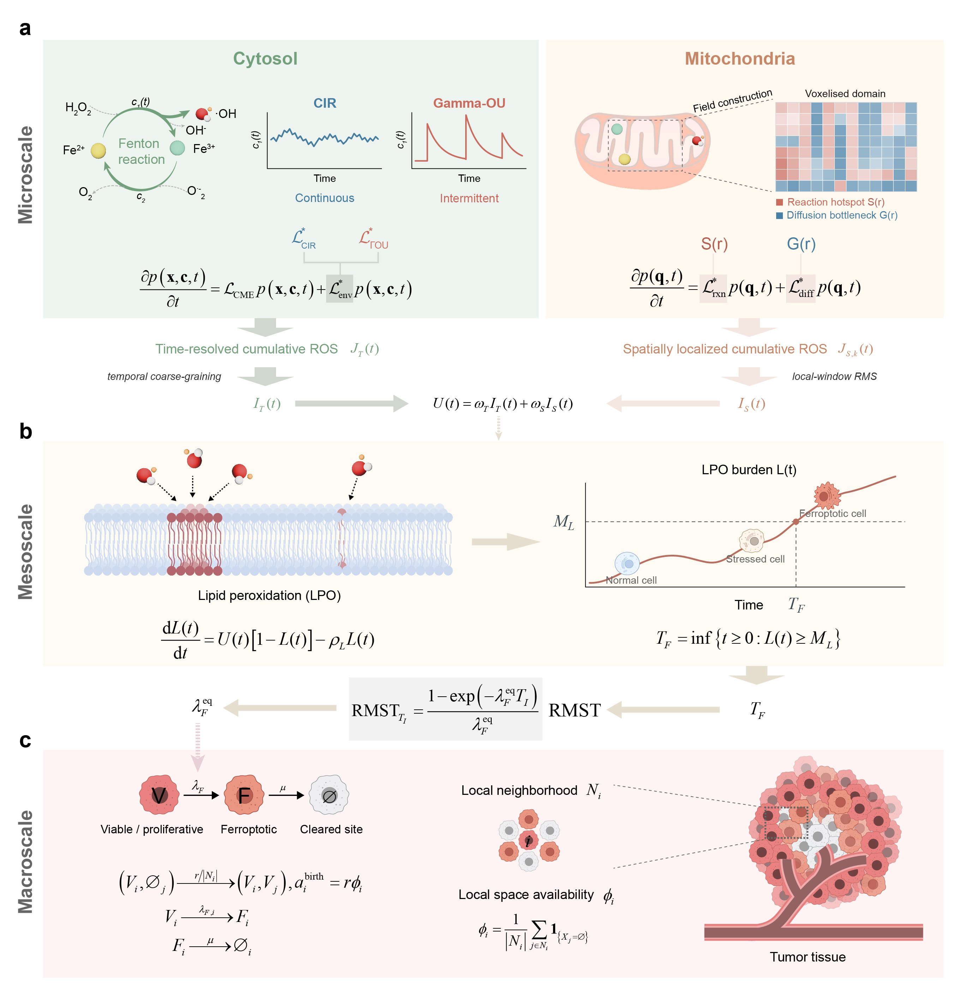

# ROS2Ferroptosis2Tumor

MATLAB code for a multiscale study of Fenton-generated reactive oxygen species (ROS), lipid peroxidation (LPO), ferroptotic commitment, and tumour growth.

## Framework overview



**Fig. 1. Multiscale stochastic framework.** The cytosolic TD-CME and mitochondrial SD-RDME provide temporal and spatial ROS inputs to the lipid peroxidation (LPO) model. The first passage of lipid damage to a fixed threshold defines ferroptotic commitment. Restricted mean survival time maps cell-level commitment to an effective rate in the spatial CTMC, which models tumor cell proliferation, ferroptotic commitment, and clearance.

## Code

| Directory | Model or analysis | Start here |
| --- | --- | --- |
| [TD-CME](code/TD-CME/) | Cytosolic time-dependent chemical master equation | `TDCME_ROSBurdenAndFPT.m` |
| [SD-RDME](code/SD-RDME/) | Mitochondrial spatially dependent reaction–diffusion master equation | `SDRDME_LocalBurdenAndFPT.m` |
| [LPO-FPT](code/LPO-FPT/) | Mesoscopic lipid peroxidation and first passage to ferroptotic commitment | `LPO_FateRoutes.m` |
| [CTMC](code/CTMC/) | Spatial tumour continuous-time Markov chain | `CTMC_MesoscopicRiskInterface.m`, then `CTMC_CommitmentClearanceScan.m` |
| [External-Validation](code/External-Validation/) | Directional comparison with independent FSP1 data | `ExternalValidation_FSP1Consistency.m` |

## Running the code

Use MATLAB R2022a or later with Statistics and Machine Learning Toolbox. Parallel Computing Toolbox enables parallel execution where supported. The scripts retain their original seeds, simulation settings, and run modes. A writable checkout with an ASCII-only path is useful for MATLAB process workers on Windows.

Set the MATLAB Current Folder to the relevant model directory before calling an entry point by filename without the `.m` extension. For example, from the checkout root:

```matlab
cd(fullfile('code','TD-CME'))
TDCME_ROSBurdenAndFPT
```

Run the two microscopic entry points before running the mesoscopic model. Then run the mesoscopic fate routes and cell-state analysis before generating the meso–macro interface and running the CTMC. The external consistency check uses the CTMC commitment and clearance scan output and two publisher workbooks. Each directory has an input and output guide.

The `final` settings reproduce the study configuration where a run mode is available. Use `smoke` or `pilot` where a script offers those modes for a smaller run. Downstream defaults look for the named final outputs. Keep reduced runs in a separate checkout or working copy because some entries write to the same paths in all modes. The spatial-coarse-graining audit defaults to its original `pilot` setting. Production runs can be computationally intensive.

## Package contents

The package includes the main simulation and analysis entry points, selected figures and robustness analyses, and four frozen CTMC inputs used for parameter locking and numerical comparison. Other model intermediates are generated by the documented workflow. Each model folder documents its simulation entry points and analyses.

Files were selected from the four final model archives and the external validation script. The CTMC solver, meso–macro interface generator and three spatial arrangement analysis drivers come from the accompanying macro production directory.
